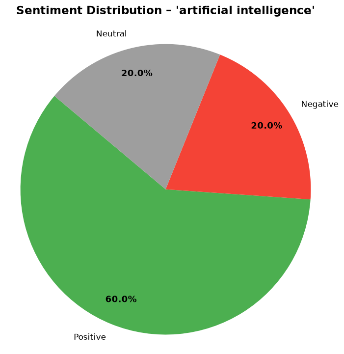
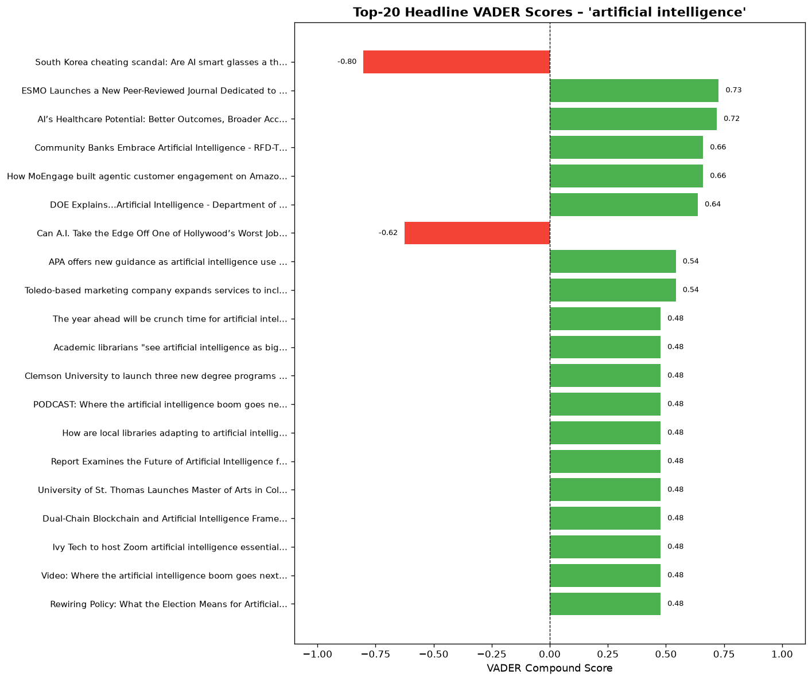

# News Headline Sentiment Analyser

A command-line tool that pulls news headlines, scores their sentiment, generates charts, and sends a daily email summary.


---

## Table of Contents

1. [Overview](#overview)
2. [How it works](#how-it-works)
3. [Tech Stack](#tech-stack)
4. [Project Structure](#project-structure)
5. [Setup](#setup)
6. [Configuration](#configuration)
7. [Usage](#usage)
8. [Output](#output)
9. [Rate limiting and scheduling](#rate-limiting-and-scheduling)

---

## Overview

The tool fetches up to 100 headlines from NewsAPI (or falls back to Google News RSS if no API key is set), scores each headline with TextBlob and VADER, produces two charts, and sends an HTML email report. It can be run once manually or left running as a daily scheduled job.

---

## How it works

```
NewsAPI / Google News RSS
       |
  Headline Fetcher
  (exponential backoff on rate limits)
       |
  Sentiment Analyser
  (TextBlob + VADER)
       |
       +---> Chart Generator --> output/charts/
       |
       +---> Email Report    --> recipient inbox
       |
       +---> JSON Report     --> output/reports/

APScheduler triggers the above pipeline on a daily cron.
```

Sentiment labels are determined by the VADER compound score:

- compound >= 0.05: **positive**
- compound <= -0.05: **negative**
- otherwise: **neutral**

---

## Tech Stack

| Library | Role |
|---------|------|
| Python 3.8+ | Core language |
| requests | HTTP client for NewsAPI and RSS |
| BeautifulSoup4 + lxml | RSS feed parser (fallback) |
| TextBlob | Polarity and subjectivity scoring |
| vaderSentiment | Compound sentiment scoring (rule-based) |
| Matplotlib | Chart generation |
| smtplib (stdlib) | Email delivery over SMTP/TLS |
| APScheduler | Daily job scheduling |
| python-dotenv | Loads `.env` file into environment variables |

---

## Project Structure

```
news-sentiment-analyser/
├── src/
│   ├── __init__.py
│   ├── fetcher.py        # NewsAPI client + Google News RSS fallback
│   ├── analyser.py       # TextBlob + VADER scoring
│   ├── visualiser.py     # Pie and bar chart generation
│   ├── emailer.py        # HTML email builder and SMTP sender
│   └── scheduler.py      # APScheduler job and pipeline runner
├── output/
│   ├── charts/           # PNG chart files
│   └── reports/          # JSON report files
├── docs/
│   ├── sample_pie.png    # Sample sentiment pie chart
│   └── sample_bar.png    # Sample VADER bar chart
├── config.py             # Reads all settings from environment variables
├── main.py               # CLI entry point
├── requirements.txt
├── .env.example
└── README.md
```

---

## Setup

### 1. Clone

```bash
git clone https://github.com/zuhafatima0810/news-sentiment-analyser.git
cd news-sentiment-analyser
```

### 2. Create a virtual environment

**Windows:**
```bash
python -m venv venv
venv\Scripts\activate
```

**macOS / Linux:**
```bash
python3 -m venv venv
source venv/bin/activate
```

### 3. Install dependencies

```bash
pip install -r requirements.txt
```

### 4. Download TextBlob corpora

```bash
python -m textblob.download_corpora
```

### 5. Set up your `.env`

```bash
cp .env.example .env
```

Fill in the values as described in [Configuration](#configuration) below.

### 6. NewsAPI key (optional)

Get a free key at [https://newsapi.org/register](https://newsapi.org/register). If `NEWS_API_KEY` is left blank or set to the placeholder value, the tool falls back to scraping the Google News RSS feed automatically.

### 7. Gmail app password (if using Gmail)

1. Enable 2-Step Verification on your Google account.
2. Go to **Settings > Security > App Passwords**.
3. Create a password for "Mail" and put it in `EMAIL_PASSWORD` in your `.env`.

---

## Configuration

All settings are read from environment variables. Copy `.env.example` to `.env` and edit it.

| Variable | Description | Default |
|----------|-------------|---------|
| `NEWS_API_KEY` | Key from newsapi.org. Leave blank to use RSS fallback. | *(empty)* |
| `EMAIL_SENDER` | Address to send reports from. | *(required for email)* |
| `EMAIL_PASSWORD` | SMTP password or app password. | *(required for email)* |
| `EMAIL_RECEIVER` | Address to receive reports. | *(required for email)* |
| `EMAIL_SMTP_HOST` | SMTP server hostname. | `smtp.gmail.com` |
| `EMAIL_SMTP_PORT` | SMTP port (TLS). | `587` |
| `QUERY` | Search term used to fetch headlines. | `technology` |
| `SOURCES` | Comma-separated NewsAPI source IDs. Leave blank for all. | *(empty)* |
| `PAGE_SIZE` | Number of headlines to fetch per run (1-100). | `50` |
| `SCHEDULE_HOUR` | Hour to run the daily job (24-hour format). | `8` |
| `SCHEDULE_MINUTE` | Minute to run the daily job. | `0` |
| `CHART_OUTPUT_DIR` | Directory for PNG chart files. | `output/charts` |
| `REPORT_OUTPUT_DIR` | Directory for JSON report files. | `output/reports` |

---

## Usage

### Run once

```bash
python main.py run
python main.py run --query "electric vehicles"
python main.py run --no-email          # skip sending the email
python main.py run --no-chart          # skip chart generation
python main.py run --output-dir ./results
```

### Run on a daily schedule

```bash
python main.py schedule
python main.py schedule --query "stock market"
```

Press **Ctrl+C** to stop.

---

## Output

| Item | Location | Format |
|------|----------|--------|
| Sentiment pie chart | `output/charts/` | PNG |
| Top-20 VADER score bar chart | `output/charts/` | PNG |
| Full analysis report | `output/reports/report_{timestamp}.json` | JSON |
| Console summary | stdout | Table |
| Daily email | Recipient inbox | HTML with inline chart |

**Pie chart:** positive / negative / neutral split across all fetched headlines:



**Bar chart:** VADER compound scores for the top 20 headlines by absolute score, colour-coded by label:



The JSON report includes per-headline TextBlob and VADER scores plus aggregate counts, so previous runs can be audited or compared.

The email embeds the pie chart as a base64-encoded inline image, so it displays correctly without external image hosting.

---

## Rate limiting and scheduling

**Rate limits.** When NewsAPI returns HTTP 429, the fetcher retries up to 3 times using exponential backoff (2 s, 4 s, 8 s). After all retries are exhausted, it falls back to the Google News RSS feed rather than failing the run.

**Scheduling.** `APScheduler`'s `BlockingScheduler` runs the pipeline as a daily cron job at the time set by `SCHEDULE_HOUR` and `SCHEDULE_MINUTE`. No system cron or external task runner is required. Start it with `python main.py schedule` and stop it with Ctrl+C.

